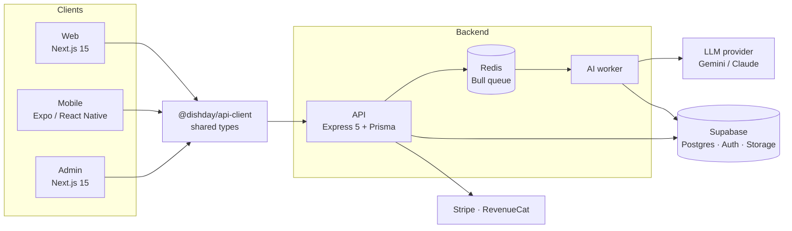

# DishDay — AI meal planning for web & mobile

**DishDay** generates a weekly meal plan from your calorie and macro targets, diet and food exclusions, then builds the shopping list for you. One product on the web, on iPhone, and in an admin panel, available in 8 languages.

🌐 **Live:** [dishday.app](https://dishday.app) · 📱 **iOS:** coming soon to the App Store

> The source code is private. This repo is a public showcase of the product, the architecture and my role in it.

<!-- Replace with real screenshots: docs/screenshots/*.png -->
| Weekly planner | AI plan generation | Recipe | Shopping list |
| --- | --- | --- | --- |
|  |  |  |  |

## Features

- **AI meal plans:** a weekly plan built from the user's profile (targets, diet, exclusions, household size), mixing recipes from the catalogue with newly generated meals
- **Nutrition tracking:** calories and macros per day and per meal, plus a food log
- **Shopping list:** ingredients from the plan, scaled to household size and grouped
- **Recipe catalogue:** 230+ curated recipes, bookmarks, and user recipes
- **8 languages:** EN, PL, DE, UK, RU, IT, ES, FR, with AI translation of recipe content
- **Admin panel:** recipe moderation, users, revenue and AI-cost dashboards

## Architecture

- **Monorepo** (Turborepo): 3 apps, 1 API and shared packages for types, API client, i18n, UI and utilities (nutrition math, units)
- **Clean API layers:** routes → services → repository interfaces → Prisma implementations, with in-memory implementations for tests
- **Async AI pipeline:** the client starts a job (`202 + jobId`), a worker calls the LLM and the client polls for progress
- **Provider-agnostic AI layer:** Gemini with automatic model fallback on quota limits, Claude as a drop-in alternative; structured JSON output validated with Zod; nutrition re-checked against our own food database; per-request token and cost logging with daily budget guards

## Tech stack

| Area | Stack |
| --- | --- |
| Web & admin | Next.js 15 (App Router), React 19, TypeScript, TanStack Query, Recharts |
| Mobile | React Native, Expo SDK 58, Expo Router, Reanimated, RevenueCat |
| Backend | Node.js, Express 5, Prisma ORM, Zod, Bull + Redis |
| Data & auth | Supabase (PostgreSQL, Auth, Storage) |
| AI | Google Gemini API, Anthropic API |
| Infra | Render (Docker), Cloudflare Workers, Sentry, Resend, GitHub Actions |

## My role

Solo project: product, design, architecture, all four apps, AI integration, CI/CD and deployment.

## Contact

Andrii Fedorchenko · Senior Frontend Engineer
[LinkedIn](https://www.linkedin.com/in/andrii-fedorchenko-829894151/) · [GitHub](https://github.com/doksel)
